<p align="center"></p>

# RIROTE VISION

An AI video studio for macOS. Describe the video in chat, or start from a script or a reference video. Then refine it on a timeline and export it.

It is built on [HyperFrames](https://github.com/heygen-com/hyperframes), which renders video from HTML compositions. The assistant uses the Claude Code you already have signed in, so the app stores no API key. Everything else it uses is free: voices, music, captions and cut-outs run on your Mac, and sound effects come from openly licensed libraries.

**Status:** version 0.1.0, an early personal project. It has only been run on one Apple Silicon Mac (macOS 27). The download is not signed by Apple, it has never been installed on a clean machine, and the Intel build is untested. Expect rough edges, and please open an issue for what you hit.

This project is not affiliated with or endorsed by HeyGen (HyperFrames) or Anthropic (Claude). You need your own Claude plan, and using it through this app is subject to Anthropic's terms.

## Features

### Start a video

- **Make:** describe the video in a sentence or two. The assistant plans the scenes, builds them with a music bed and timed sound effects, and shows you the timeline.
- **Script:** paste your words and pick a voice, or keep the words on screen. The script stays exactly as you wrote it.
- **Reference:** pick a video you have studied and say what yours is about. You get your own video in that format. Nothing of the reference is copied.
- **Brand kits:** keep a business's colours, fonts, logo and tone once, and apply them to any new or existing video.
- **Shapes:** portrait 9:16, landscape 16:9 or square 1:1.

### References

- **Study a video** from a link or a file you drop in. The app finds its shots, takes a still of each, transcribes any speech and works out the format: pacing, scene kinds, text on screen and energy.
- **Watch** the original again from the References screen or from Home. It plays from the copy on your Mac.
- **Spoken references** get a voiceover in the new video by default. You can pick the voice or turn it off.
- References live in an app-wide library and are never placed in a project.

### The assistant

- **Ask for an edit or a whole video** in plain language. It works on the open project and shows its progress as steps, not commands.
- **Undo a whole turn** from History. Each request is recorded as one entry.
- **Free sources only.** It never signs you in to a paid service. It asks before using one of your accounts or guessing what "my website" means.
- **Trust levels:** by default it works without stopping to ask. Choose **Ask every time** or **Trusted video work** in the assistant panel if you want it to check with you first.

### Edit

- **Preview and timeline:** play the composition, drag clips to move them, drag edges to trim, then split, duplicate, delete, change tracks and volume, with undo and redo.
- **Waveforms and filmstrips** inside clips, so you can see what you are cutting.
- **Text editing:** cut a clip by deleting words from its transcript. Remove filler words and shorten long pauses in one click.
- **Captions** made from the transcript, in ready-made caption styles.
- **Looks:** tested colour presets for video and image clips.
- **Blocks:** ready-made transitions, titles, overlays, charts and textures from the HyperFrames registry, added to the project as editable source.
- **Review notes** pinned to a moment and a spot on the frame. **Fix with AI** hands the open notes to the assistant.

### Media

- **Import** footage, images and sound by dragging them in. **Delete** moves a file to the Trash and warns you first if a scene still uses it.
- **Voiceover:** free male and female voices that run on your Mac. You can hear each voice before choosing it.
- **Music beds:** original instrumentals made on your Mac to a mood and length.
- **Sound effects and music** from Openverse, with each credit saved in the project's `assets/sounds/CREDITS.txt`.
- **Background cut-outs** for people in footage.

### Export

- **MP4, MOV, WebM or GIF**, with checks before rendering and verification after.
- Exports run in a queue with the other long jobs, so you can keep editing.

### Around the app

- **Sidebar:** Search, New video, Home, Editor, References, Brand kits and Settings, with shortcuts. It shrinks to icons in narrow windows.
- **Search everything** with **⌘K**. Press **⌘/** for all keyboard shortcuts.
- **Home** shows your recent projects with a still of each.

## What you need

| Requirement | Why | How to get it |
|---|---|---|
| A Mac running macOS 13 or later | The app is macOS only | Apple Silicon is what it has been run on; an Intel Mac must build from source and is untested |
| [Claude Code](https://claude.com/claude-code), signed in with your own paid Claude plan | The assistant runs on it | Install it, run `claude` once in Terminal and sign in |
| Node.js 22 or later | Runs the video engine | `brew install node` |
| FFmpeg | Encodes exports and reads media | `brew install ffmpeg` |
| Git | Fetches the video skills | `xcode-select --install` |

The `brew` commands need [Homebrew](https://brew.sh). You don't need Python: voiceover and music use a copy of Python that the app downloads into its own folder.

## Install

### Option A: download it (recommended)

1. Download the latest **RIROTE-VISION-…-mac.dmg** from [Releases](https://github.com/rishabhsisodiya/rirote-vision/releases/latest). One file works on both Apple Silicon and Intel Macs.
2. Open it and drag **RIROTE VISION** into **Applications**.
3. Open the app. The first time, macOS blocks it, because the app is not signed by an Apple developer account. Go to **System Settings > Privacy & Security**, scroll down to the message about RIROTE VISION, click **Open Anyway** and confirm. You only do this once.

Then follow **First run** below. You don't need npm, Rust or the source code.

### Option B: build it yourself

Building from source avoids the macOS warning. You also need [Rust](https://rustup.rs) and the Xcode command line tools (`xcode-select --install`).

```bash
git clone https://github.com/rishabhsisodiya/rirote-vision.git
cd rirote-vision
npm install
npm run install-app
```

`install-app` builds the app and copies it to `/Applications`. Quit the app first if it is open. The first build takes a few minutes. An app you build yourself opens without a macOS warning.

If the build says `cargo` cannot be found, load Rust into the terminal and run it again:

```bash
source "$HOME/.cargo/env" && npm run install-app
```

### If macOS says the app is damaged

That message sometimes appears instead of **Open Anyway** for unsigned apps. Clear the block once in Terminal, then open the app again:

```bash
xattr -dr com.apple.quarantine "/Applications/RIROTE VISION.app"
```

## First run

1. Open the app, then choose **RIROTE VISION > Check Setup…** from the menu bar at the top of the screen.
2. Install what it offers, in this order:
   - **Install Video Engine** (required, about 120 MB)
   - **Install Video Skills** (required; these are HyperFrames' instructions for Claude Code, saved in `~/.claude/skills`)
   - **Install Voiceover and Music** (optional; a one-time download of about 400 MB into the app's own folder)
   - **Install yt-dlp** (optional; needed only to study references from a link)
3. Every required row should say **Ready**. If Claude Code, Node.js or FFmpeg shows as missing, install it from the table above and click **Check Again**.
4. **Render browser** may not be ready on a new Mac. The engine normally downloads its own copy of Chrome when it first needs one, but that has not been tried on a fresh machine. If an export fails for this reason, open an issue with the logs (see below).

## Make a video

1. On **Home**, choose **Make**, **Script** or **Reference**, and pick a shape. For example:

   > A 25-second launch video for https://example.com: a hook, what we build, two highlights and a closing card with the URL. Use real screenshots of the site.

2. The app creates the project and the assistant starts building it. Watch the preview and timeline fill in.
3. Refine it by chat or by hand on the timeline.
4. Click **Export**. Files are saved in the project's `renders` folder.

## Good to know

- **Your projects are ordinary folders.** The app opens them in place and never uploads them.
- **Opening a project changes its `index.html`.** The engine adds ids it needs for editing and creates a `.hyperframes` folder.
- **The assistant uses your Claude plan.** Each request counts against your usage limits.
- **What goes online:** the assistant (through Claude Code), reference downloads from a link, and sound searches on Openverse. Voiceover, music, transcription, captions, cut-outs and exports run on your Mac.
- **The preview is close, the export is exact.** The preview runs in the app's WebKit window. It plays each sound once and skips the engine's automatic music ducking, so the mix can sound slightly different. The exported file is rendered in Chrome with the full mix.

## If something goes wrong

| Problem | Try |
|---|---|
| "The app is damaged" or it will not open | Run the `xattr` command under Install, or build from source |
| A required row in Check Setup stays Missing | Install it, then quit and reopen the app so it sees the new tool |
| The assistant says it needs video skills | Check Setup, then Install Video Skills |
| Voiceover or music fails | Check Setup, then Install Voiceover and Music |
| A reference link will not download | Check Setup, then Install yt-dlp, or drop the video file in instead |
| The preview does not start | Click **Start Preview Again**; if it persists, send the logs below |

Logs are in `~/Library/Application Support/com.riroteglobal.vision/logs/`. Attach `app.log` and `preview-server.log` to any bug report, after checking them for anything private: they contain the paths of your project folders.

## Developing

```bash
npm install
npm run tauri dev      # run the app with live reload
npm test               # frontend unit tests
cargo test -p rirote-vision                             # Rust unit tests
cargo test -p rirote-vision -- --ignored --nocapture    # live tests
npm run app            # build the app bundle
npm run install-app    # build and copy to /Applications (quit the app first)
npm run release        # the disk image for Apple Silicon and Intel
```

To publish a release, set the version in `src-tauri/tauri.conf.json`, commit, then push a matching tag such as `v0.1.0`. GitHub builds the disk image and attaches it to the release (`.github/workflows/release.yml`).

The live tests download the engine, render video and run real Claude Code sessions on your plan, so they are not run by default.

| Folder | What is in it |
|---|---|
| `src/` | The interface: React and TypeScript |
| `src-tauri/src/` | The app's core in Rust: projects, preview, timeline, assistant, media, references, brand kits, export |
| `src-tauri/src/reference/` | Studying reference videos: download, shots, stills, transcript, analysis |
| `src-tauri/resources/` | The music synth script carried inside the app |
| `docs/` | Notes on distribution |

The video engine is pinned to HyperFrames 0.9.9 in `src-tauri/src/hyperframes.rs`.

## Licence

RIROTE VISION is released under the [MIT License](LICENSE).

It builds on other people's work, each under its own licence:

| Software | Licence | How it is used |
|---|---|---|
| [HyperFrames](https://github.com/heygen-com/hyperframes) engine and skills | Apache-2.0 | Downloaded onto your Mac by Check Setup; not included in this repository |
| `@hyperframes/player` | Apache-2.0 | Built into the app to play the preview |
| [Tauri](https://tauri.app) | MIT or Apache-2.0 | The app shell |
| [React](https://react.dev) | MIT | The interface |
| [yt-dlp](https://github.com/yt-dlp/yt-dlp) | Unlicense | Downloaded by Check Setup to fetch references from a link |
| Python, from [python-build-standalone](https://github.com/astral-sh/python-build-standalone) | PSF License | Downloaded by Check Setup for voiceover and music |
| Space Mono and Bebas Neue fonts | SIL Open Font License 1.1 | Built into the app |

The speech (Kokoro), transcription and background-removal models are downloaded by the engine when first used and carry their own licences. Sounds from Openverse carry their own Creative Commons licences, credited in each project. Claude Code is Anthropic's software and is not part of this project.
